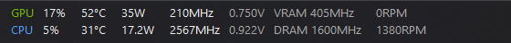
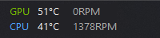
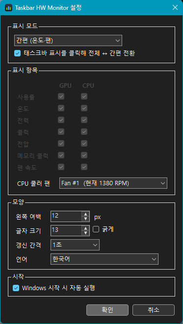

# Taskbar HW Monitor

Windows 11 태스크바 왼쪽 빈 공간에 GPU·CPU 상태를 실시간으로 보여 주는 작은 앱입니다.
설정 화면은 한국어 · English · 简体中文 · 日本語를 지원합니다.

**전체 보기**



**간편 보기** (온도·팬만) — 태스크바 표시를 클릭할 때마다 전체 ↔ 간편이 바뀝니다.



| 줄 | 사용률 | 온도 | 전력 | 클럭 | 전압 | 메모리 클럭 | 팬 |
|---|---|---|---|---|---|---|---|
| **GPU** | GPU Core 부하 | GPU Core | 보드 전력 | 코어 클럭 | 코어 전압 | VRAM 클럭 | GPU 팬 RPM |
| **CPU** | 전체 부하 | 패키지 | 패키지 전력 | 코어 평균 클럭 | 코어 전압 | DRAM 클럭 | CPU 쿨러 RPM |

- 온도가 80°C 이상이면 주황, 90°C 이상이면 빨강으로 표시됩니다.
- 태스크바의 자식 창으로 붙기 때문에 전체 화면 게임에서는 태스크바와 함께 자동으로 숨겨집니다.
- 배경은 실제 태스크바 색을 읽어 채우고 ClearType으로 그려서 글자가 선명하고, 숫자 사이 빈 곳을 눌러도 클릭됩니다.
- 탐색기가 재시작되어도 2초 안에 태스크바에 다시 붙습니다.
- **Windows 11 위젯(날씨) 대체:** 설치할 때 고르면 위젯 버튼이 있던 왼쪽 자리를 대신 씁니다. 아래 [위젯 대체](#windows-11-위젯-대체)를 참고하세요.
- 작업 표시줄이 왼쪽 정렬이면 시작 버튼과 겹치지 않도록 알림 영역 왼쪽에 표시됩니다.

## 설치

[Releases](../../releases)에서 `TaskbarHwMon-Setup-x.y.z.exe`를 받아 실행합니다.

- 필요: Windows 10/11 x64, [.NET 10 Desktop Runtime](https://dotnet.microsoft.com/download/dotnet/10.0)
- 처음에 **설치 언어**를 고릅니다 (한국어 / English / 日本語 / 简体中文). 고른 언어가 앱 설정 화면의 기본 언어가 됩니다.
- **Windows 시작 시 자동 실행**을 선택하면 작업 스케줄러에 등록되어 로그인할 때 UAC 창 없이 관리자 권한으로 실행됩니다.
- **Windows 11 위젯 대신 사용**을 선택하면 기본 위젯을 제거합니다 (기본값은 선택 안 함).
- 제거는 Windows **설정 › 앱**에서 할 수 있습니다.

> CPU 온도·전력·전압과 메인보드 팬 RPM을 읽으려면 관리자 권한이 필요합니다 ([LibreHardwareMonitor](https://github.com/LibreHardwareMonitor/LibreHardwareMonitor) + PawnIO 드라이버).
> PawnIO가 설치되어 있지 않으면 일부 CPU 값이 `-`로 나올 수 있습니다.

## 사용법

- **전체 ↔ 간편 전환:** 태스크바 표시를 클릭하거나, 트레이 아이콘 우클릭 › **간편 보기**.
- **설정 열기:** 트레이 아이콘을 클릭하거나, 시작 메뉴에서 앱을 한 번 더 실행하거나, 태스크바 표시를 우클릭합니다.
- **종료:** 트레이 아이콘을 우클릭한 뒤 **종료**를 누릅니다.



설정 창에서 바꾼 값은 태스크바에 바로 미리 보이며, **확인**을 눌러야 저장됩니다.

| 설정 | 설명 |
|---|---|
| 표시 모드 | 전체 / 간편(온도·팬). 클릭 전환을 끄면 태스크바 표시를 눌러도 바뀌지 않습니다 |
| 표시 항목 | 전체 모드에서 보일 GPU/CPU 항목. 한 줄의 항목을 모두 끄면 그 줄은 숨겨집니다 |
| CPU 쿨러 팬 | 메인보드 팬 중 CPU 쿨러에 해당하는 것을 고릅니다 (현재 RPM이 함께 표시됨) |
| 왼쪽 여백 | 위젯 버튼과 겹치면 늘려 주세요 |
| 글자 크기 / 굵게 | |
| 갱신 간격 | 0.5 / 1 / 2 / 5초 |
| 언어 | 자동(Windows 언어) / 한국어 / English / 简体中文 / 日本語 |

설정 파일은 `%APPDATA%\TaskbarHwMon\config.json`에 저장됩니다.

## Windows 11 위젯 대체

설치할 때 **Windows 11 위젯 대신 사용**을 선택하면 다음 작업을 합니다.

1. 정책 `HKLM\SOFTWARE\Policies\Microsoft\Dsh\AllowNewsAndInterests = 0`을 설정해 위젯 버튼과 날씨를 끕니다.
2. Windows Web Experience Pack(`MicrosoftWindows.Client.WebExperience`)을 모든 사용자에게서 제거하고, 새 사용자에게도 설치되지 않도록 프로비저닝에서도 뺍니다.
3. 적용을 위해 탐색기를 다시 시작합니다. 열려 있는 파일 탐색기 창은 닫힙니다.

앱을 제거하면, 이 앱이 위젯을 제거했던 경우에만 정책을 되돌리고 탐색기를 다시 시작합니다. 위젯 패키지가 없으면 Microsoft Store의 Windows Web Experience Pack 페이지가 열리니 거기서 다시 설치하면 됩니다.

### 참고

- DRAM은 실시간 클럭 센서가 없어서 메모리 설정 속도(MT/s)의 절반, 즉 실제 클럭을 표시합니다. DDR4-3200이면 1600MHz로 나옵니다.
- CPU 클럭은 모든 코어 클럭의 평균입니다.

## 빌드

```powershell
winget install Microsoft.DotNet.SDK.10
winget install JRSoftware.InnoSetup
./build.ps1      # publish\ 게시 + out\TaskbarHwMon-Setup-<버전>.exe 생성
```

| 경로 | 내용 |
|---|---|
| `app/` | WinForms 앱 (.NET 10). UI 문자열은 `app/Strings.cs` |
| `installer/TaskbarHwMon.iss` | Inno Setup 스크립트 (설치 언어 선택 포함) |
| `installer/ChineseSimplified.isl` | Inno Setup 简体中文 메시지 ([jrsoftware/issrc](https://github.com/jrsoftware/issrc)) |
| `tools/make-icon.ps1` | `app/app.ico` 생성 |

## 라이선스

MIT. 센서 읽기에는 [LibreHardwareMonitorLib](https://github.com/LibreHardwareMonitor/LibreHardwareMonitor)(MPL-2.0)를 사용합니다.
